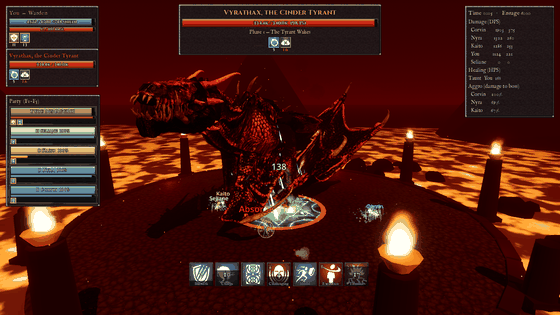
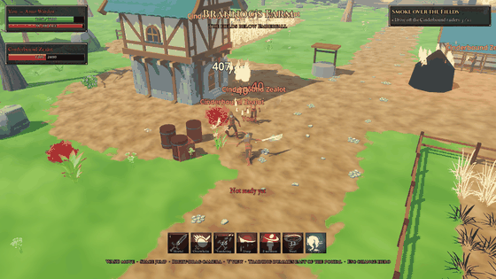
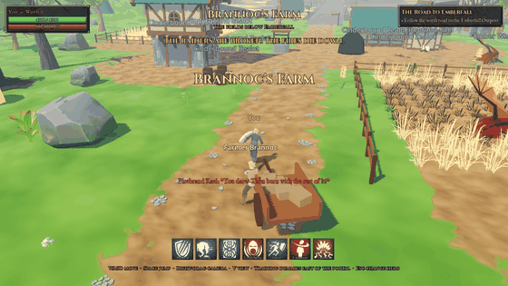
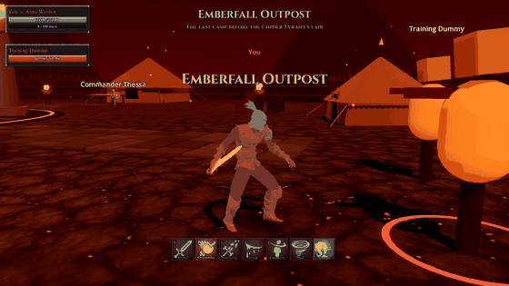
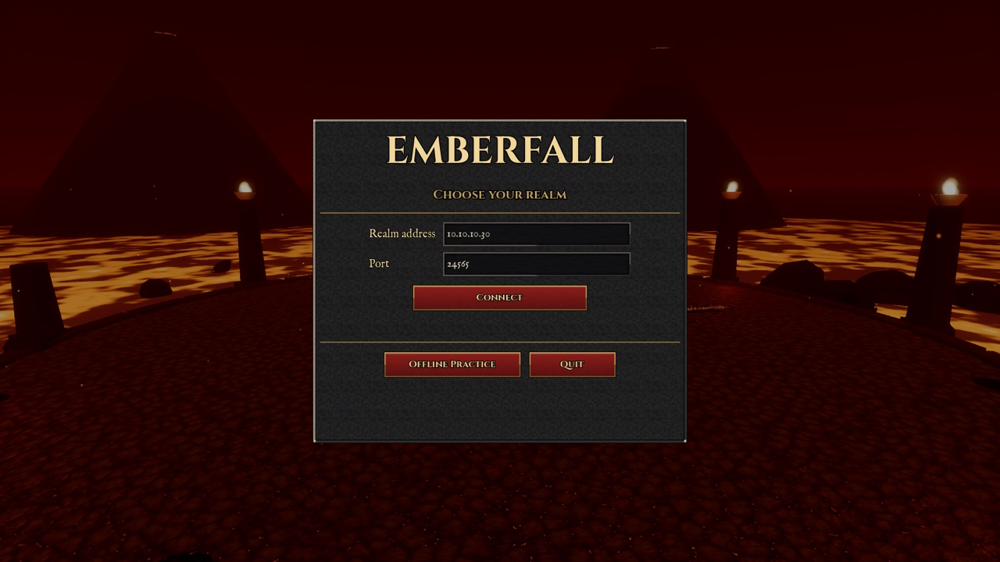

# Emberfall

A small co-op fantasy RPG for macOS and Windows, made with Godot 4.7 and GDScript.
Start on a burning farm, walk the Ashen Causeway north to the Emberfall Outpost, gather a war party, then face
**Vyrathax, the Cinder Tyrant**, a giant three-phase fire dragon. Play solo with bots or with friends on a realm.



| | |
|---|---|
|  |  |
| *Brannoc's farm: drive off the Cinderbound raiders* | *The Ashen Causeway: from the farm's daylight to the Outpost's ash* |
|  |  |
| *Skills: Frost Storm, Mortal Blow, Steel Cyclone, Sundering Blow* | *Realm select* |

- **Design doc:** [DESIGN.md](DESIGN.md) covers stats, every skill, boss phases and bot AI.
- **All numbers:** `scripts/data/game_data.gd`. Balancing means editing that file.

## What's in the game

- **One open world.** Brannoc's farm, the Ashen Causeway across the lava sea and the Emberfall Outpost form one
  continuous map: no loading between them. The sky changes from a clear day over the farm to ash and fire over the
  Outpost as you walk, and each zone's name appears as you enter it.
- **A starting quest.** New heroes arrive on the farm road while Cinderbound zealots and Ember Whelps burn the farm.
  Talk to Farmer Brannoc, drive off the raiders, defeat their leader Firebrand Kael, then follow the road north to
  the Outpost. After that, you start in the Outpost.
- **Five classes:** Warden (tank), Arms Warden (greatsword DPS), Oracle (healer), Blademaster (rogue) and
  Arcanist (frost mage). Heroes are rigged, animated characters with real weapons and shields.
- **The raid:** a giant dragon with three phases, flame breath, meteors, whelps and a final inferno, for 5 heroes
  (bots fill empty seats).
- **Online:** an Outpost shared with everyone on the realm, war parties, chat, rejoining after a disconnect.

## Download and play

Get the latest build from the [Releases page](https://github.com/vitvara/emberfall/releases): no install needed.

- **Windows:** download `Emberfall-windows.zip`, unzip it and run `Emberfall.exe`. Keep the `.dll` next to the
  `.exe` (it's the terrain library). If SmartScreen warns, click **More info → Run anyway**.
- **macOS:** download `Emberfall-macos.dmg`, open it and drag `Emberfall.app` to Applications. The first time,
  **right-click → Open** (or System Settings → Privacy & Security → **Open Anyway**), because the app isn't notarized.
  If macOS says the app is damaged, run `xattr -dr com.apple.quarantine /Applications/Emberfall.app` once.

Then pick **Offline Practice** to play solo with bots, or connect to a realm (below).

## Run from source

```sh
./run.sh            # play
./run.sh editor     # open in the Godot editor
./run.sh server          # dedicated party server on port 24565 (no window)
./run.sh sim arcanist 5   # headless balance test: 5 all-bot fights
```

Godot is installed at `~/Applications/Godot.app`. Set `GODOT=/path/to/Godot` to use a different copy.

### Art packs (not in this repo)

Characters, animations, nature and farm buildings come from [Quaternius](https://quaternius.com) packs. Some of their
licences don't allow sharing the raw files, so they're git-ignored and only ship inside the game builds. Without them
the game still runs, with simple shapes instead. To get the full look from source, download the free (Standard)
versions and copy their glTF/GLB exports into `assets/models/quaternius/`:

| Pack | Copy into |
|---|---|
| Characters - Fantasy Races Kit (GLB) | `assets/models/quaternius/` (the four race `.glb` files and their textures) |
| Modular Character Outfits - Fantasy (glTF) | `assets/models/quaternius/outfits/` |
| Universal Animation Library and Universal Animation Library 2 (Unreal-Godot GLB) | `assets/models/quaternius/anim/` |
| Stylized Nature MegaKit (glTF and textures) | `assets/models/quaternius/nature/` |
| Fantasy Props MegaKit (glTF) | `assets/models/quaternius/props/` |
| Medieval village buildings (FBX) | `assets/models/quaternius/buildings/` |

Then run `./run.sh editor` once so Godot imports them.

### Dev flags

After `--`:

| Flag | What it does |
|---|---|
| `--autostart=<class> [--autoplay]` | Start the raid right away (bots can play your hero) |
| `--hub=<class>` | Start in the Outpost |
| `--farm=<class> [--farmbot] [--farmstage=leader\|saved]` | Start the farm quest fresh; `--farmbot` plays it by itself |
| `--hubtrain[=<skill>]` | Stand at the training dummies and repeat a skill |
| `--herocam=x,y,z`, `--cam=x,y,z,lx,ly,lz` | Fixed camera following the hero, or at a world position |
| `--screenshot=<file.png> --shot-at=<sec> [--shots=N --shot-every=<sec>]` | Screenshots (and frame series) |
| `--perf [--perfoff=fx,shadow,terrain,glow,lights]` | Print FPS, draw calls and triangles; switch parts off to compare |
| `--fxtest=<skill_id>`, `--speed=4`, `--zoom=6` | Loop a skill's visuals, speed up time, camera distance |

## Playing together

1. Run a realm: `./run.sh server` (or use ours, see below).
2. Players start the game, type the **realm address** and click **Connect**. The game remembers the last one.
3. **Log in**, or click **Create an account** (name: 3-16 letters, numbers or `_`; password: 6+ characters).
   Accounts live on the realm. Passwords are stored as salted PBKDF2-SHA256 hashes, and the connection is
   DTLS-encrypted.
4. **Choose your hero** (any class, duplicates are fine). A new hero starts on Brannoc's farm (the farm quest runs
   in your own game); once it's done you arrive in the **Outpost**, where you see everyone logged in to the realm.
   Press **Enter** to chat.
5. Walk through the **raid portal** (or press **Esc**) to open the **War Party** window: **Create Party**, or
   **Join** one from the list. Each party has 5 seats; **Change Hero** switches your class.
6. The party leader (marked ♛) can **Add Bot** on empty seats and set each bot's class, and is the only one who
   can **Start Raid**. Seats still empty at the start get bots that fill a missing tank or healer first. Several
   parties can raid at the same time.
7. After the fight the leader picks **Retry** or **Back to Outpost**. If someone disconnects mid-fight, a bot
   takes over their character.
8. **Crashed or dropped?** Start the game, connect and log in again. The **Raid in Progress** screen offers
   **Rejoin Raid**, which takes your hero back from the bot. You can also rejoin through the portal while the raid lasts.
9. **Esc** in a raid opens the game menu: **Resume**, **Settings** (coming soon), **Surrender** (starts a party
   vote; a majority of connected players must agree within 30 s, then the party returns to the Outpost) and **Quit Game**.

**Aggro:** a taunt (the Warden's Challenging Shout) holds a monster on the tank for 20 s. Without a taunt, a
monster attacks whoever has dealt it the most damage, so tanks must keep taunting.

**Offline Practice** on the realm screen is the solo mode with bots.

## Our realm

The party server runs privately and is reached over Cloudflare WARP. Turn WARP on, type realm `10.10.10.30`,
then log in or register. Ask the host for access.

## Controls

WASD to move · Space to jump · 7 = ground skill (click to place) · right-drag to turn the camera · V to switch camera view · mouse wheel to zoom · left-click or Tab to target ·
F1–F5 to target party members · 1–7 for skills · C for the character sheet · F to answer a quest dialog ·
Esc for the game menu (or to cancel ground targeting). Hover over a skill button to see its tooltip.

## Code map

| File | What it does |
|---|---|
| `scripts/data/game_data.gd` | Class stats, skills, auras and boss numbers |
| `scripts/core/unit.gd` | Combatant: stats, casting, cooldowns, auras, damage, aggro (taunt lock, damage table) |
| `scripts/core/raid_world.gd` | Fight loop, unit lists, events, meters, floating text |
| `scripts/core/hazard.gd` | Ground telegraphs (circles and cones) |
| `scripts/ai/bot_brain.gd` | Tank, healer, melee and ranged bot AI |
| `scripts/ai/dragon_brain.gd` | Boss phases and abilities |
| `scripts/ai/whelp_brain.gd` | Raid add AI |
| `scripts/ai/mob_brain.gd` | Open-world monsters: aggro groups, chase, leash, steering around obstacles |
| `scripts/player/player_controller.gd` | Input, camera, targeting |
| `scripts/ui/hud.gd` | Menu, frames, action bar, meters, end screen |
| `scripts/visuals/models.gd` | Mesh and material helpers, and the model factory |
| `scripts/visuals/char_model.gd` | Rigged character (race head + outfit + animation tree with action layers) |
| `scripts/visuals/hero_rig.gd` | Hero visuals: animation choice, weapons, skill poses, effects (falls back to built-in shapes without the art packs) |
| `scripts/visuals/hero_ik.gd` | Skeleton modifier: spine twist and arm IK after the animation |
| `scripts/visuals/mob_rig.gd` | Animated monsters and NPCs (torches, weapons) |
| `scripts/visuals/weapon_models.gd` | Mounts weapon and shield models in the hand |
| `scripts/visuals/dragon_rig.gd` | Jointed dragon and whelp models and their animations |
| `scripts/visuals/dragon_skin.gd` | Puts the sculpted boss model on the dragon rig and copies its pose to the model's bones every frame |
| `scripts/visuals/vfx.gd` | Particle and mesh effects library |
| `scripts/visuals/skill_fx.gd` | Maps each skill and boss event to its animation and effects |
| `scripts/visuals/projectile.gd` | Spell missiles and falling meteors |
| `scripts/visuals/weapon_trail.gd` | Glowing swing trails on weapons |
| `scripts/core/ground_zone.gd` | Mouse-placed ground skills (Frost Storm, Poison Bomb, Sanctuary) |
| `scripts/main.gd` | Arena, menus and modes (solo, online client, dedicated server), headless sim, dev flags |
| `scripts/net/net.gd` | Networking autoload: accounts, Outpost sync, war parties (one raid each), chat, player input, snapshots and events |
| `scripts/ui/menu_ui.gd` | Realm, login, Choose Your Hero, War Party window, rejoin screen |
| `scripts/world/hub_world.gd` | The open world: Outpost camp, raid portal, Ashen Causeway, zones, day/night sky, other players, chat |
| `scripts/world/farm_region.gd` | Brannoc's farm: scenery, raiders, the quest and its dialog |
| `scripts/world/world_terrain.gd` | Terrain3D hills and painted paths; the causeway road |
| `scripts/world/hub_controller.gd` | Walking the Outpost (movement and camera) |
| `scripts/world/env_kit.gd` | Shared scenery pieces (stone, rocks, lava sea, volcanoes, braziers) |
| `scripts/ui/ui_theme.gd` | Medieval UI kit generated in code (iron frames, crimson buttons, parchment, bars) |
| `shaders/` | Shield bubble, lava, portal vortex, dragon skin |
| `addons/terrain_3d/` | [Terrain3D](https://github.com/TokisanGames/Terrain3D) 1.1, MIT |
| `addons/road-generator/` | [Godot Road Generator](https://github.com/TheDuckCow/godot-road-generator) 0.9.5, MIT |
| `assets/models/weapons/` | Medieval Weapons Pack by Quaternius, CC0 |
| `assets/models/dragon/` | Boss model "DRAGO" by Oscar Creativo, CC BY 4.0 (see its CREDITS.md); client only |
| `assets/icons/` | Skill icons from game-icons.net, CC BY 3.0 (see its CREDITS.md) |
| `assets/icon/` | App icon (`emberfall_icon.svg` source, `.icns` for macOS, `.ico` for Windows) |
| `assets/fonts/` | Cinzel and IM Fell English, SIL Open Font License |
